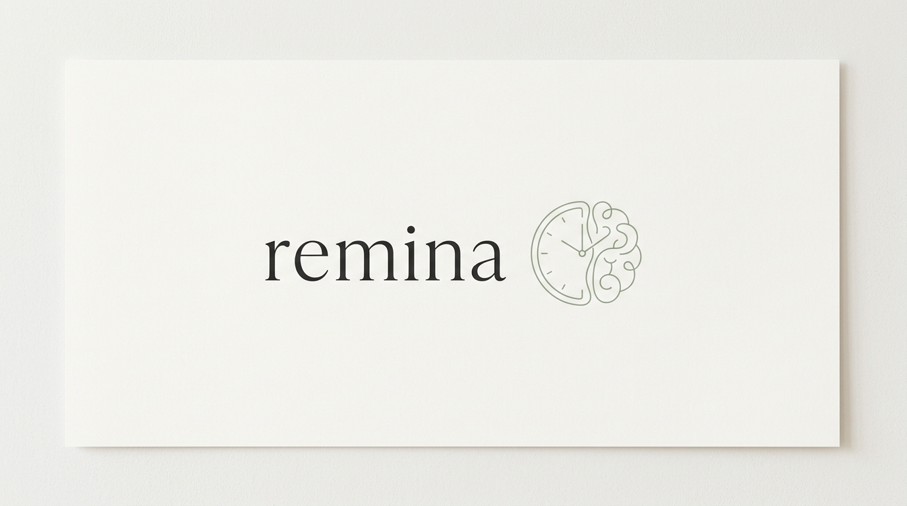
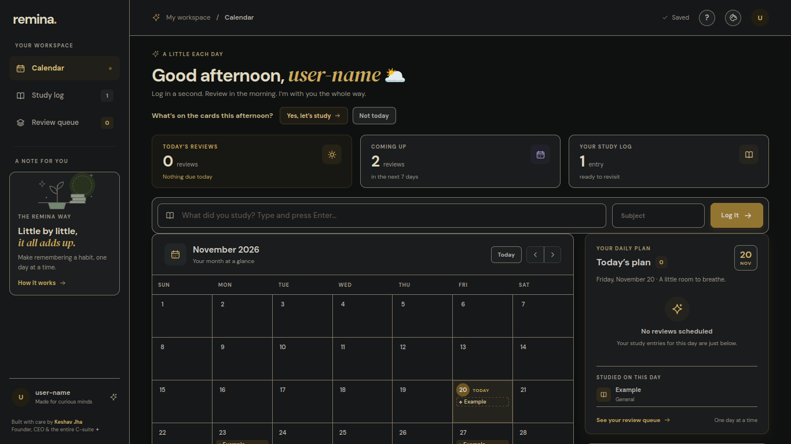
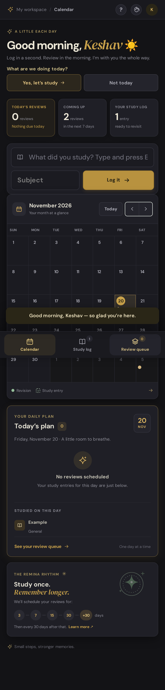
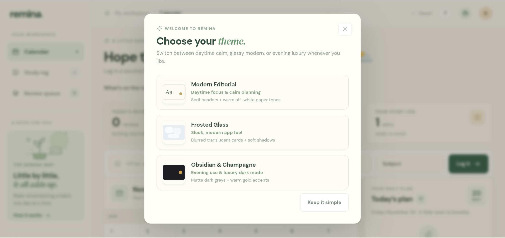

<div align="center">

# Remina — Spaced Revision & Study Planner

**Log what you study. Let Remina bring it back at the perfect moment.**



[Live Preview](https://keshav-cmd.github.io/Remina/) · [Download the Android APK](https://github.com/Keshav-cmd/Remina/raw/refs/heads/main/app/Remina.apk)

`study` · `review` · `remember` · `repeat`

</div>

---

Remina is a personalized **spaced-revision planner** for students, learners, and lifelong learners. It brings one-second study logging, an automatic revision calendar, a clear morning to-do, and warm companion greetings into one responsive, beautifully designed interface.

Use Remina to log what you studied, let the app schedule reviews at increasing intervals, and make remembering a habit — one day at a time, without the crunch of cramming.

> **Our vision:** A calmer way to remember what you learn — where small, daily reviews build lasting memory, and knowledge sticks without boundaries.

## Contents

- [Features](#features)
- [Screenshots](#screenshots)
- [Live preview](#live-preview)
- [Android app](#android-app)
- [Getting started](#getting-started)
- [Keyboard shortcuts](#keyboard-shortcuts)
- [The Remina rhythm](#the-remina-rhythm)
- [Technology](#technology)
- [Project structure](#project-structure)
- [Roadmap](#roadmap)
- [Contributing](#contributing)
- [License](#license)
- [Creator](#creator)
- [Keywords](#keywords)

## Features

### Smart spaced-revision scheduling

- Automatic review scheduling using the proven **3 · 7 · 15 · 30 + 30** rhythm.
- After day 30, reviews repeat **every 30 days** (day 60, 90, 120…) — fixed intervals, no guesswork.
- Every topic gets its own review timeline, visible at a glance on the calendar.

### One-second study logging

- **Quick-add bar**: type what you studied, pick or type a subject, press **Enter** — done in a second.
- Subjects are fully flexible; Remina remembers your last-used one and suggests the rest as you type.
- Optional notes per entry, plus a full entry editor for back-dating and details.

### Your morning to-do, front and center

- The **Today's plan** panel shows every review due today with a live progress bar.
- Big, satisfying **check buttons** — mark a review complete with one tap and watch it check off.
- Overdue reviews are flagged, so nothing slips through the cracks.

### Calendar at a glance

- Monthly calendar with **color-coded review chips** — each subject gets its own tone.
- Select any day to see its reviews, study entries, and progress.
- Today, the selected day, and upcoming reviews are always visually distinct.

### Study log & review queue

- **Study log**: every entry with studied date, subject, notes, and next review date — searchable.
- **Review queue**: overdue, today, upcoming, and recently completed reviews, grouped clearly.
- Filter the queue by *To review*, *All*, or *Done*.

### A warm study companion

- **Time-aware greetings by name**: *"Good morning, Keshav"*, *"Good evening"*, *"Still up"*, *"Burning the midnight oil"* — Remina greets you in the moment you open it.
- **Daily pace question**: *"So, what are we doing today?"* — answer **Yes, let's study** or **Not today**.
- First visit: pick your theme, then tell Remina your name — personal from the very first minute.

### Three beautiful themes

- **Modern Editorial** — daytime calm: serif headers, warm off-white paper tones.
- **Frosted Glass** — sleek, modern app feel: blurred translucent cards over a soft gradient.
- **Obsidian & Champagne** — evening luxury: matte dark greys with warm gold accents.
- Switch anytime from the theme button; your choice is saved, and the browser theme color follows.

### Mobile-first, desktop-perfect

- **Native-app feel on phones**: bottom tab bar, bottom-sheet dialogs, enlarged touch targets.
- No input-zoom jumps, safe-area aware for notched phones, sticky top bar while scrolling.
- Desktop is equally polished — one codebase, every screen.

### Private & local

- Everything is stored **on your device** (localStorage) — no accounts, no servers, no tracking.
- The status bar simply says **Saved**. Your study data never leaves your browser.

> Features and data persistence can vary by version. Check the current application for what is available.

## Screenshots

Real captures of Remina running live — desktop, mobile, and the first-visit theme picker.

### 🖥️ Desktop — Obsidian & Champagne



> *The full dashboard: warm named greeting, quick-add bar, stats, the revision calendar, and today's plan — in the Obsidian & Champagne dark theme.*

### 📱 Mobile — Obsidian & Champagne



> *Mobile-first layout: bottom tab bar, sticky top bar, and the calendar with today's plan — every tap target built for thumbs.*

### 🎨 First-visit theme picker



> *Onboarding in style: pick your space first — Modern Editorial, Frosted Glass, or Obsidian & Champagne — then tell Remina your name.*

## Live preview

Try the web application: **[keshav-cmd.github.io/Remina](https://keshav-cmd.github.io/Remina/)**

## Android app

Download the Remina Android package from the repository:

**[Download Remina.apk](https://github.com/Keshav-cmd/Remina/raw/refs/heads/main/app/Remina.apk)**

The APK is stored at `app/Remina.apk` in this repository. On Android, open the downloaded APK and follow the device's installation prompts. Android may ask you to allow installation from the source you used. Install APKs only from sources you trust.

## Getting started

### Requirements

- A modern web browser.
- Git (for cloning the repository).
- A code editor such as Visual Studio Code (optional).

### Run locally

```bash
git clone https://github.com/Keshav-cmd/Remina.git
cd Remina
```

Open `index.html` in a browser, or run the folder with a local development server such as the Visual Studio Code **Live Server** extension.

## Keyboard shortcuts

| Shortcut | Action |
| --- | --- |
| `n` or `/` | Focus the quick-add bar (on the calendar view) |
| `Esc` | Close the active dialog |

## The Remina rhythm

For every topic you log, Remina schedules reviews on these days after you studied it:

| Stage | When | Purpose |
| --- | --- | --- |
| 1st review | Day 3 | First recall — catches the forgetting curve early |
| 2nd review | Day 7 | Strengthens the memory a week later |
| 3rd review | Day 15 | Mid-term retention |
| 4th review | Day 30 | First long-term review |
| Ongoing | +30 every month | Day 60, 90, 120… — keeps it in long-term memory |

**The routine is simple:** log it, revisit it, check it off, and watch it grow.

## Technology

Remina uses lightweight web technologies to deliver an interactive, responsive learning experience.

| Technology | Use |
| --- | --- |
| HTML5 | Application structure |
| CSS3 | Styling, layouts, themes, and responsive design |
| JavaScript | Application logic and interactions |
| SVG | Lightweight interface icons |
| Local Storage | Client-side persistence |

## Project structure

```text
Remina/
├── index.html              # Main application interface
├── styles.css              # Styling, themes, and responsive layouts
├── app.js                  # Application logic and interactions
├── README.md               # Project documentation
├── patch.md                # Patch log — every change recorded
├── app/
│   └── Remina.apk          # Android application package
└── assets/                 # Poster, screenshots, fonts, and icons
```

## Roadmap

Potential future directions include the following. These are ideas, not a promise that the features are currently available.

- [ ] Cloud sync across devices (with privacy controls)
- [ ] Push reminders for due reviews
- [ ] Custom review intervals per subject
- [ ] Study statistics, streaks, and heatmaps
- [ ] Import/export for backing up your data
- [ ] Installable, offline-capable PWA

## Contributing

Bug reports, suggestions, and contributions are welcome. To propose a change:

1. Fork this repository.
2. Create a branch:
   ```bash
   git checkout -b feature/your-feature
   ```
3. Make and test your changes.
4. Commit your work:
   ```bash
   git commit -m "Add: describe your change"
   ```
5. Push the branch and open a Pull Request.

## License

Remina is released under the **MIT License** — free to use, study, modify, and distribute. See the [LICENSE](LICENSE) file for details.

## Creator

**Keshav Jha** created **Remina — Spaced Revision & Study Planner**, an independent project for making remembering a habit, one day at a time.

## Keywords

`spaced repetition app` · `spaced revision planner` · `revision planner` · `study planner` · `spaced repetition calendar` · `memory app` · `remember what you study` · `3-7-15-30 revision schedule` · `daily study log` · `study companion app` · `Keshav Jha`

---

<div align="center">

**REMINA · MEMORY WITHOUT BOUNDARIES**

*Study once. Remember longer.*

</div>
